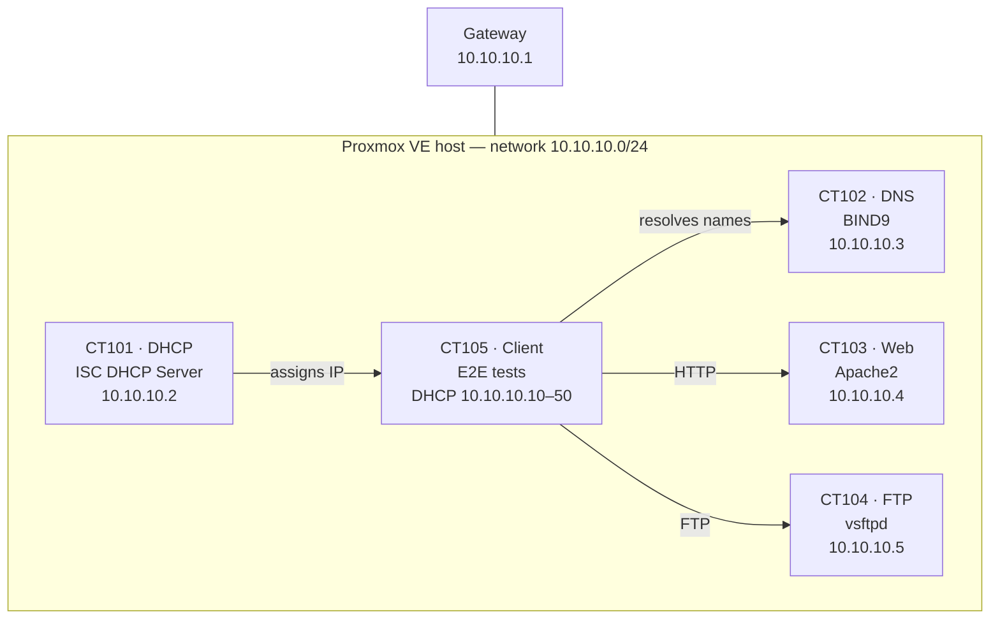

<h1 align="center">Network Services on Proxmox VE</h1>

<p align="center">
  Virtualized lab network built on <strong>Proxmox VE</strong> with LXC containers running
  <strong>DHCP</strong>, <strong>DNS</strong>, <strong>Web</strong> and <strong>FTP</strong> services,
  automated with Bash scripts and validated with end-to-end tests.
</p>

<p align="center">
  
  
  
  
  <br/>
  
  
  
  
</p>

<p align="center">
  <em>Operating Systems Administration (ASO) — Unit 1 Project, Group 3</em>
</p>

---

## Overview

This project deploys a complete internal network inside Proxmox VE. Each core service runs in its own **LXC container** based on Ubuntu Server, and a dedicated client container verifies that everything works end to end: the client receives an IP via DHCP, resolves names through DNS, loads the website and logs in to the FTP server.

## Network Topology



| Container | Role | Hostname | IP address | Software |
|---|---|---|---|---|
| CT101 | DHCP server | `dhcp.lab.internal` | `10.10.10.2` | ISC DHCP Server |
| CT102 | DNS server | `dns.lab.internal` | `10.10.10.3` | BIND9 |
| CT103 | Web server | `web.lab.internal` | `10.10.10.4` | Apache2 |
| CT104 | FTP server | `ftp.lab.internal` | `10.10.10.5` | vsftpd |
| CT105 | Test client | — | DHCP (`10.10.10.10`–`10.10.10.50`) | — |

## Services

### DHCP — ISC DHCP Server
- Subnet `10.10.10.0/24`, dynamic range `10.10.10.10` – `10.10.10.50`.
- Gateway `10.10.10.1`, DNS server `10.10.10.3`, domain `lab.internal`.
- Default lease 10 minutes, maximum lease 2 hours.

### DNS — BIND9
- Forward zone **`lab.internal`** with A records for `dns`, `dhcp`, `web` and `ftp`.
- Reverse zone for **`10.10.10.0/24`**.

### Web — Apache2
- Serves the lab website from `config/www/index.html` at `http://web.lab.internal`.

### FTP — vsftpd
- FTP server at `ftp.lab.internal` with authenticated user access.

## Repository Structure

```
Py1-G3-ASO/
├── config/
│   ├── dhcpd.conf            # DHCP scope and options
│   ├── named.conf.local      # BIND9 zone declarations
│   ├── db.lab.internal       # Forward zone (lab.internal)
│   ├── db.10.10.10.rev       # Reverse zone (10.10.10.0/24)
│   ├── lab.conf              # Apache virtual host
│   ├── vsftpd.conf           # FTP server configuration
│   └── www/index.html        # Website content
├── scripts/
│   ├── install_dhcp.sh
│   ├── install_dns.sh
│   ├── install_web.sh
│   ├── install_ftp.sh
│   └── uninstall_all.sh
├── evidencias/               # Screenshots of each step and test
├── informe/                  # Full project report (PDF, Spanish)
└── LICENSE
```

## Deployment

1. **Create the containers.** In the Proxmox web UI, download the Ubuntu Server LXC template and create CT101 to CT105 on the `10.10.10.0/24` network.
2. **Copy the configuration.** Copy each file from `config/` to its matching path under `/etc/` in the corresponding container.
3. **Run the install script** inside each container:

   ```bash
   chmod +x scripts/*.sh

   ./scripts/install_dhcp.sh   # CT101
   ./scripts/install_dns.sh    # CT102
   ./scripts/install_web.sh    # CT103
   ./scripts/install_ftp.sh    # CT104
   ```

4. **Test from the client (CT105)** following the end-to-end plan below.

To remove everything, run `./scripts/uninstall_all.sh`.

## End-to-End Tests

Run from the client container CT105:

```bash
ip a                              # Received an IP in 10.10.10.10–50 from DHCP
nslookup web.lab.internal         # Resolves to 10.10.10.4
nslookup 10.10.10.5               # Reverse lookup returns ftp.lab.internal
curl http://web.lab.internal      # Returns the lab website
ftp ftp.lab.internal              # Logs in to the FTP server
```

## Evidence

<table>
  <tr>
    <td align="center"><br/><sub>Client receives IP via DHCP</sub></td>
    <td align="center"><br/><sub>DNS resolution</sub></td>
  </tr>
  <tr>
    <td align="center"><br/><sub>DNS and Web from the client</sub></td>
    <td align="center"><br/><sub>FTP login from the client</sub></td>
  </tr>
</table>

All screenshots are in [`evidencias/`](evidencias/), and the full report is in [`informe/`](informe/).

## Author

**Esteban Larco** — Information Technology Engineering student at Universidad de las Fuerzas Armadas ESPE, Santo Domingo campus. November 2025.

[](https://github.com/EMLarco)
[](https://www.linkedin.com/in/esteban-larco-66491843b)

## License

This project is licensed under the terms of the [LICENSE](LICENSE) file.
